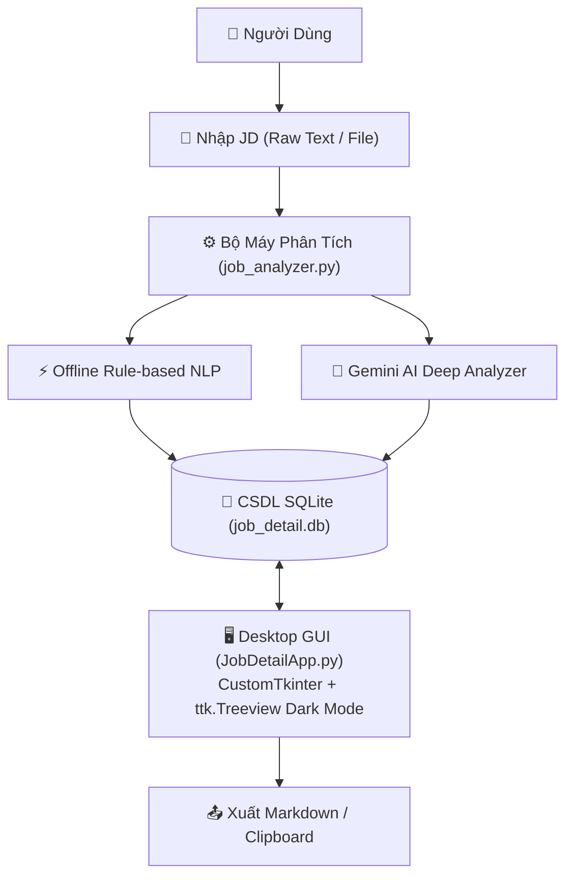

# 💼 JobDetail Intelligence Hub

Hệ thống quản lý, phân tích và tra cứu Bản mô tả công việc (Job Description - JD) thông minh, giúp người dùng nhanh chóng nắm bắt công việc từ cơ bản đến chi tiết nhất theo **Mô hình 5 Tầng Kiến Thức (5-Tier Job Intelligence Model)**.

---

## 🎯 Mục Đích Ứng Dụng

Khi bạn tiếp cận một tin tuyển dụng hay một JD mới, việc đọc văn bản thô thường gây quá tải hoặc mơ hồ về những gì thực sự cần học và chuẩn bị. **JobDetail Intelligence Hub** giải quyết triệt để vấn đề này:
1. **Bóc tách từ đơn giản đến chi tiết**: Từ tóm tắt ngắn gọn vai trò (hiểu trong 30s) $\rightarrow$ ma trận kỹ năng bắt buộc/ưu tiên $\rightarrow$ lộ trình Onboarding theo tuần/tháng $\rightarrow$ kho tài liệu chính thống $\rightarrow$ bộ câu hỏi phỏng vấn thực chiến.
2. **Bộ máy phân tích kép (Dual-Engine)**:
   - **Offline Smart Engine**: Chạy tức thì 0s, 100% riêng tư và offline, tự động trích xuất thực thể, kỹ năng và ánh xạ lộ trình/tài liệu chuẩn.
   - **Gemini AI Engine**: Tích hợp AI phân tích sâu, trả lời các bài toán tình huống sát sườn theo JD.
3. **Tra cứu & Tìm kiếm tức thì (Instant Search)**: Lọc đa chiều theo từ khóa, cấp bậc (Intern, Junior, Mid, Senior, Lead), lĩnh vực (Backend, Frontend, Fullstack, DevOps, AI, Mobile, QA).
4. **Quản lý tiến độ học tập**: Đánh dấu trạng thái (`New`, `Learning`, `Ready`, `Applied`), ghi chú cá nhân và tích chọn checklist công việc.
5. **Xuất báo cáo**: Sao chép hoặc xuất toàn bộ hồ sơ phân tích ra file Markdown (`.md`) chuẩn đẹp.

---

## 🏗️ Kiến Trúc Hệ Thống



---

## 🚀 Hướng Dẫn Sử Dụng

### 1. Khởi động nhanh
Nhấp đúp chuột vào file:
```
Run_JobDetail.bat
```
Hoặc chạy lệnh từ terminal:
```bash
python JobDetailApp.py
```

### 2. Thêm và Phân tích JD Mới
1. Bấm nút **`[➕ Thêm JD Mới]`** trên thanh tiêu đề.
2. Dán nội dung tuyển dụng (JD) vào khung soạn thảo.
3. Chọn chế độ:
   - *Offline Thông Minh*: Phân tích siêu tốc tức thì không cần mạng.
   - *Gemini AI*: Điền API Key nếu muốn phân tích chuyên sâu.
4. Bấm **`[🚀 Bắt Đầu Phân Tích & Lưu]`**.

### 3. Tra Cứu & Học Tập
- Gõ từ khóa vào ô tìm kiếm để lọc ngay lập tức.
- Chọn cấp bậc (Level) hoặc lĩnh vực (Ngành) trên bộ lọc combobox.
- Xem chi tiết qua 6 tab:
  * **Tab 1: 📋 Tổng quan**: Mục tiêu và hình thức làm việc.
  * **Tab 2: 🛠️ Ma trận Kỹ năng**: Must-have (đỏ), Nice-to-have (xanh), Tools (xanh dương), Soft skills (vàng).
  * **Tab 3: 🧭 Lộ trình Nắm bắt**: Chặng Tuần 1-2, Tháng 1, Tháng 2-3 kèm checklist hành động.
  * **Tab 4: 📚 Kho Tài liệu**: Nút "🔗 Mở Web" mở ngay tài liệu chính thức (Official Docs) trên trình duyệt, danh mục sách kinh điển và từ khóa vàng.
  * **Tab 5: ❓ Phỏng vấn & Thực chiến**: Các câu hỏi cốt lõi kèm gợi ý trả lời chuyên sâu.
  * **Tab 6: 📝 Ghi chú & JD gốc**: Nơi bạn ghi chép quá trình ôn tập và xem lại nguyên văn JD.
