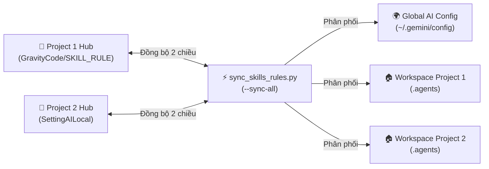

# 🧭 TRUNG TÂM KỸ NĂNG & QUY CHUẨN ĐỊA PHƯƠNG (SETTING AI LOCAL - PROJECT 2)

Kho lưu trữ song song và trạm đồng bộ 2 chiều (Bidirectional Hub) giữa **Project 1** (`.../Project1/GravityCode/SKILL_RULE`) và **Project 2** (`.../Project2/SettingAILocal`) cùng cấu hình người dùng toàn cục `~/.gemini/config/`.

---

## 🏗️ Kiến Trúc Đồng Bộ 2 Chiều (Multi-Hub 2-Way Architecture)

Hệ thống đảm bảo tính toàn vẹn và nhất quán 100% giữa các dự án:
1. **Hub 1 (Project 1)**: `C:\Users\games\Desktop\Project\Python\Python MyWork\Project1\GravityCode\SKILL_RULE`
2. **Hub 2 (Project 2)**: `C:\Users\games\Desktop\Project\Python\Python MyWork\Project2\SettingAILocal`
3. **Global AI Configuration**: `C:\Users\games\.gemini\config\`
4. **Workspaces (.agents)**: Tự động nạp khi mở thư mục làm việc trong Antigravity IDE.



---

## ⚡ Các Lệnh Thao Tác Nhanh

Mở terminal tại `SettingAILocal` hoặc khởi chạy qua `Run_SkillRuleHub.bat`:

```powershell
# 1. Đồng bộ 2 chiều toàn diện giữa Project 1, Project 2 và Global:
python sync_skills_rules.py --sync-all

# 2. Kiểm tra tình trạng đồng bộ 3 tầng:
python sync_skills_rules.py --check

# 3. Quét thu hoạch kỹ năng / quy tắc mới từ các dự án con:
python sync_skills_rules.py --harvest
```

---

## 📚 Danh Mục Kỹ Năng & Quy Chuẩn (25 Skills & 10 Rules)

- **Skills**: `.system`, `add_host_checklist`, `ai_firewall_proxy_relay`, `antigravity_ide_ext_dev`, `chrome_ext_offline_decouple`, `copilot_addon_dev`, `customtkinter_perf_ui`, `enterprise_intramart_automation`, `fb_media_downloader`, `gemini_api_key_handling`, `generate_roadmap`, `imagegen`, `ldplayer_game_pipeline`, `openai-docs`, `openclaw-fb-addon-check`, `pdf_coordinate_stamping`, `plugin-creator`, `pypack_exe_builder`, `python_auto_install`, `qmh_download_pipeline`, `review-agent`, `skill-creator`, `skill-installer`, `vocab_ai_media`, `web_gantt_excel_exporter`.
- **Rules**: `AI_RULES.md`, `chrome_extension_standards.md`, `encoding_rules.md`, `enterprise_addon_standards.md`, `gemini_api_policy.md`, `pdf_precision_standards.md`, `python_desktop_standards.md`, `skill_rule_sync_protocol.md`, `vocab_ai_content_rules.md`, `workflow_rules.md`.

